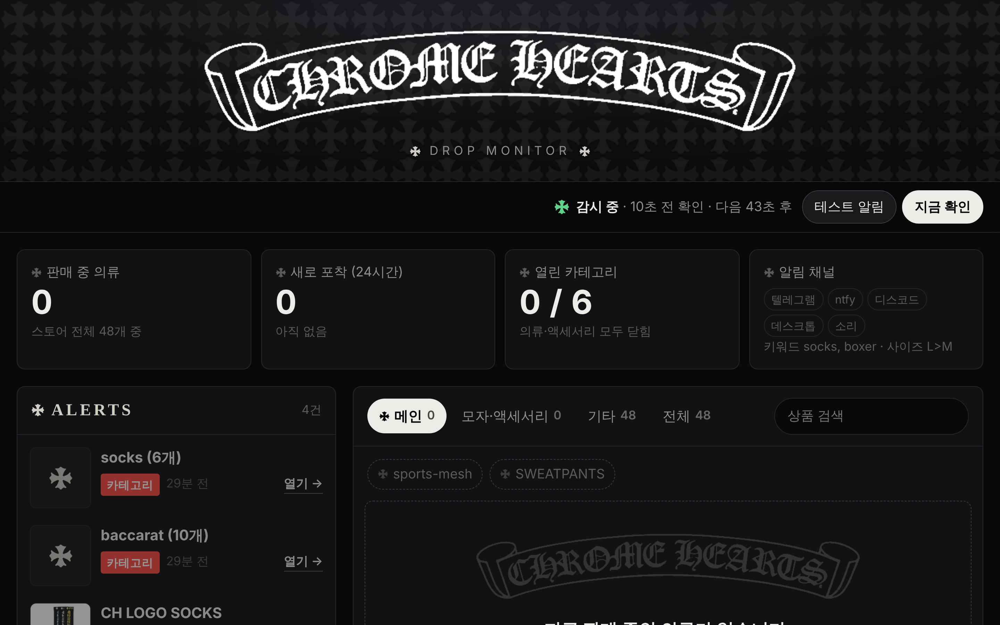

# Chrome Hearts 드롭 모니터

chromehearts.com 공식 스토어를 주기적으로 확인하다가 **새 드롭이 뜨면 바로 알리고, 원하는 사이즈가 선택된 구매 페이지를 열어 줍니다.**
Python 3.9 이상만 있으면 되고 추가 설치는 없습니다.

## 무엇을 감지하나

| 이벤트 | 뜻 |
|---|---|
| 🆕 신상품 `new_product` | 처음 보는 상품이 스토어에 올라옴 |
| 🔁 재등록 `relisted` | 목록에서 빠졌던 상품이 다시 올라옴 |
| 📦 재입고 `restock` | 품절이던 사이즈가 다시 구매 가능해짐 (감시 키워드 상품만) |
| 🚪 카테고리 오픈 `category_open` | 비어 있던 카테고리(hoodie, hat, eyewear 등)에 상품이 생김 |
| 💲 가격 변경 `price_change` | 가격이 바뀜 |

동작 방식: 스토어의 전체 상품 그리드(`cgid=root`)를 먼저 읽어 상품 변화를 바로 알리고,
그다음 사이트맵에 있는 카테고리를 한 페이지씩 확인합니다. 지금은 hoodie·hat·eyewear 등
대부분 카테고리가 닫혀 있고(홈으로 리다이렉트) 드롭 때 열리기 때문에, 카테고리 오픈 알림이
가장 빠른 드롭 신호가 될 때가 많습니다.

**처음 실행하면** 현재 상품을 기준으로 저장만 하고 알림은 보내지 않습니다. 두 번째 확인부터 알림이 갑니다.

## 빠른 시작

```bash
cd drop-monitor
cp config.example.json config.json   # 설정 편집
python3 -m chmonitor --list          # 지금 판매 중인 상품 보기 (접속 확인)
python3 -m chmonitor --setup-telegram  # 텔레그램 연결 (아래 참고)
python3 -m chmonitor --test-notify   # 알림 채널 테스트
python3 -m chmonitor --dashboard     # 감시 + 대시보드 (http://127.0.0.1:8787)
python3 -m chmonitor                 # 대시보드 없이 감시만 (Ctrl+C로 종료)
```

## 상품 그룹

상품은 이름과 스토어 카테고리로 세 그룹으로 나뉩니다 (`chmonitor/groups.py`).

| 그룹 | 무엇 | 대시보드 | 알림 |
|---|---|---|---|
| **메인** `main` | 후디·집업, 맨투맨·크루넥, 티셔츠·셔츠, 팬츠·스웻팬츠·쇼츠, 자켓·코트·베스트 등 아우터, 그리고 처음 보는 종류 | 첫 화면 | 보냄 |
| **모자·액세서리** `accessory` | 모자·비니, 아이웨어, 스카프, 슬리퍼, 가방, 주얼리 | 별도 탭 | 보냄 |
| **기타** `other` | Baccarat 글라스, 향·캔들·인센스, 속옷·레깅스, 양말 | 별도 탭 | 안 보냄 |

분류가 애매한 새 상품은 놓치지 않도록 메인으로 들어갑니다.

## 대시보드

`python3 -m chmonitor --dashboard`를 실행하면 감시를 시작하고 브라우저에 `http://127.0.0.1:8787`을 엽니다
(`--port 9000`으로 포트 변경, `--no-browser`로 자동 열기 끄기).

- 상단: 감시 상태(마지막 확인·다음 확인까지 남은 시간·접속 오류), **지금 확인**, **테스트 알림** 버튼
- 요약: 판매 중 상품 수, 열린/닫힌 카테고리, 최근 24시간 알림 수, 켜진 알림 채널
- 알림 기록: 신상품·재등록·재입고·카테고리 오픈이 사진, 시간, **구매 →** 링크와 함께 쌓임 (`state.json`에 최근 300건 저장)
- 스토어 탭: **메인**(새로 포착 → 의류 순, 닫힌 의류 카테고리 표시) / 모자·액세서리 / 기타 / 전체.
  상품 사진, 가격, 사이즈별 재고(품절은 취소선, 선호 사이즈는 굵게), 새로 포착한 상품은 붉은 테두리와 **NEW**.
  구매 버튼은 선호 사이즈가 선택된 페이지로 바로 갑니다
- 새 알림이 오면 탭 제목이 🚨로 바뀝니다



대시보드는 이 컴퓨터(127.0.0.1)에서만 열리고, 봇 토큰 같은 비밀값은 화면에 보내지 않습니다.

다른 옵션: `--once` (한 번만 확인), `--reset` (기준 다시 잡기), `-v` (자세한 로그), `-c 경로` (다른 설정 파일).

## 설정 (`config.json`)

| 키 | 기본값 | 설명 |
|---|---|---|
| `interval_seconds` | 60 | 확인 간격(초). 최소 20초. 매번 ±20% 무작위로 흔들림 |
| `keywords` | `[]` | 이 단어가 상품명/카테고리에 있을 때만 알림. 비우면 전부 |
| `preferred_sizes` | `[]` | 구매 링크에 미리 선택할 사이즈 순서. `"L"`, `"LRG"` 둘 다 됨. 재고 있는 첫 사이즈를 고름 |
| `usd_krw` | `null` | 원화 환율을 고정하고 싶을 때 (예: `1450`). 비우면 실시간 환율(6시간마다, open.er-api.com) |
| `usd_krw_fallback` | 1400 | 실시간 환율을 못 받았을 때 쓰는 값. 대시보드 하단에 "기본값"으로 표시됨 |
| `alert_groups` | `["main", "accessory"]` | 알림을 보낼 상품 그룹. `"other"`를 넣으면 Baccarat·향·속옷도 알림 |
| `track_stock` | `watchlist` | 재입고 감시 범위: `watchlist`(키워드 상품) / `all` / `off` |
| `auto_open_browser` | `true` | 알림과 동시에 기본 브라우저로 구매 페이지 열기 |
| `auto_open_on` | 신상품·재등록·재입고·카테고리 | 브라우저를 열 이벤트 종류 |
| `categories` | `[]` | 직접 지정할 카테고리 id. 비우면 사이트맵에서 자동으로 읽음 |

예: 후디·모자만 L 사이즈로 노리기

```json
{ "keywords": ["hoodie", "hat", "cap"], "preferred_sizes": ["L", "M"] }
```

## 알림 채널

여러 개를 동시에 켤 수 있습니다. 토큰은 `config.json` 대신 환경변수로 줘도 됩니다
(`CH_TELEGRAM_BOT_TOKEN`, `CH_TELEGRAM_CHAT_ID`, `CH_DISCORD_WEBHOOK_URL`, `CH_NTFY_TOPIC`).
`config.json`은 `.gitignore`에 들어 있어 커밋되지 않습니다.

- **데스크톱 알림 + 소리** (`desktop`, `sound`): macOS·Windows·Linux 기본 지원.
  macOS에서 `brew install terminal-notifier`를 하면 알림을 클릭할 때 구매 페이지가 열립니다.
- **휴대폰 푸시: ntfy** (가장 간단, 가입 없음): 휴대폰에 ntfy 앱을 설치하고 아무도 못 맞힐 토픽 이름을
  구독한 뒤 같은 이름을 `ntfy.topic`에 넣고 `enabled: true`. 알림에 **🛒 바로 구매** 버튼이 붙습니다.
- **Telegram** (추천): `python3 -m chmonitor --setup-telegram` 한 번이면 끝납니다.
  1. 텔레그램에서 **@BotFather** → `/newbot` → 봇 이름과 아이디(…bot으로 끝남)를 정하면 토큰을 줍니다.
  2. 토큰을 붙여 넣습니다(화면에 안 보임). 봇 확인 후 `t.me/<봇아이디>` 링크가 나옵니다.
  3. 휴대폰에서 그 봇을 열고 **시작**을 누르면 chat_id를 자동으로 찾아 `config.json`에 저장하고 테스트 메시지를 보냅니다.

  알림은 상품 사진 + 이름/가격 + **🛒 바로 구매** 버튼(선호 사이즈 선택된 링크)으로 옵니다.
  그룹 채팅으로 받으려면 봇을 그룹에 초대한 뒤 그룹에서 메시지를 보내면 됩니다.
  토큰은 `config.json`(권한 600, git 제외)에 저장되며, 원하면 환경변수 `CH_TELEGRAM_BOT_TOKEN`·`CH_TELEGRAM_CHAT_ID`로 대신 줄 수 있습니다.
- **Discord**: 채널 설정 → 연동 → 웹후크 URL을 `discord.webhook_url`에. `mention_user_id`를 넣으면 멘션됩니다.

## 계속 켜 두기

알림과 브라우저 열기는 **내 컴퓨터에서** 돌릴 때 의미가 있습니다. 노트북이 잠자기에 들어가면 멈추니 주의하세요.

- macOS: `caffeinate -i python3 -m chmonitor` (잠자기 방지)
- 항상 켜진 서버/라즈베리파이: `nohup python3 -m chmonitor > monitor.log 2>&1 &`
  (서버에서는 `desktop`/`auto_open_browser`를 끄고 ntfy·Telegram으로 받으세요)

## "바로 구매"의 범위

알림을 받으면 **원하는 사이즈가 이미 선택된 상품 페이지**가 열리므로, 로그인된 브라우저에서
장바구니 담기 → 결제만 누르면 됩니다. 결제까지 자동으로 하는 기능(자동 체크아웃 봇)은 넣지 않았습니다.
스토어 이용약관 위반이 될 수 있고, 봇 탐지에 걸리면 계정·주문이 취소되거나 IP가 막힐 수 있으며,
카드 정보를 스크립트에 넣어야 하기 때문입니다.

같은 이유로 확인 간격은 최소 20초로 막아 두었고, 요청 사이에도 0.5초 이상 쉽니다.
사이트가 계속 응답하지 않으면 간격을 늘려(최대 10분) 다시 시도하고, 3번 연속 실패하면 알려 줍니다.

## 문제 해결

- **대시보드 로고가 깨지거나 "이전 버전으로 실행 중" 경고가 뜸**: `git pull` 뒤에 예전 대시보드가 계속 켜져 있는 경우입니다.
  그 터미널에서 Ctrl+C로 끄고 다시 `python3 -m chmonitor --dashboard`.
- **"포트 8787을 이미 쓰고 있습니다"**: 예전 대시보드가 다른 터미널에서 실행 중입니다. `lsof -ti tcp:8787 | xargs kill` 후 다시 실행.
- **CERTIFICATE_VERIFY_FAILED**: python.org 파이썬이면 `open "/Applications/Python 3.13/Install Certificates.command"` 한 번 실행.
- **No module named chmonitor**: `drop-monitor` 폴더 안에서 실행해야 합니다 (`cd ~/chusherlock/drop-monitor`).

## 개발

```bash
python3 -m unittest discover -s tests -t .
```

- `chmonitor/site.py` — 사이트 요청과 HTML/JSON 파싱 (Salesforce Commerce Cloud 스토어)
- `chmonitor/detect.py` — 이전/현재 상태를 비교해 이벤트 생성
- `chmonitor/notify.py` — 알림 채널과 구매 링크
- `chmonitor/monitor.py` — 감시 루프, 상태 파일(`state.json`), 명령줄
- `chmonitor/telegram.py` — 텔레그램 전송과 `--setup-telegram`
- `chmonitor/dashboard.py`, `dashboard.html` — 로컬 대시보드 서버와 화면

사이트 구조가 바뀌면 `--list`가 0개를 보여 줍니다. 그때는 `site.py`의 `parse_grid`를 고치면 됩니다.
